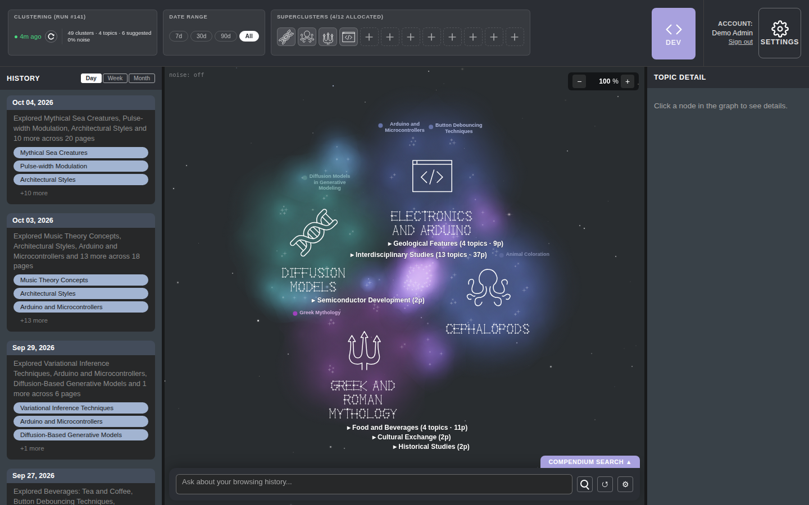
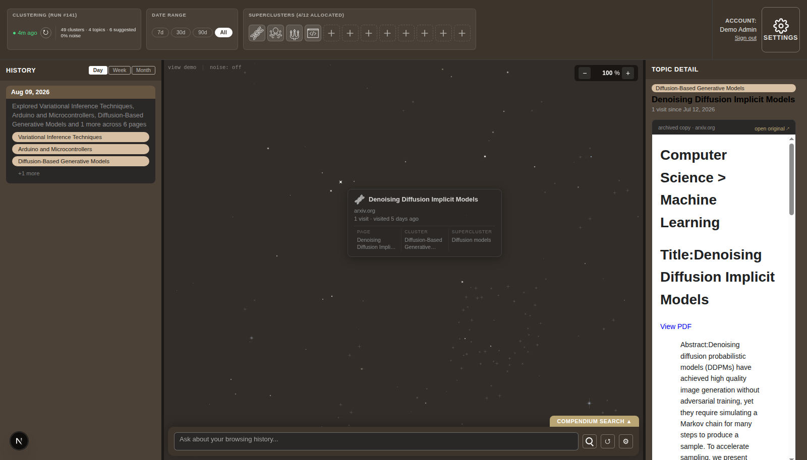
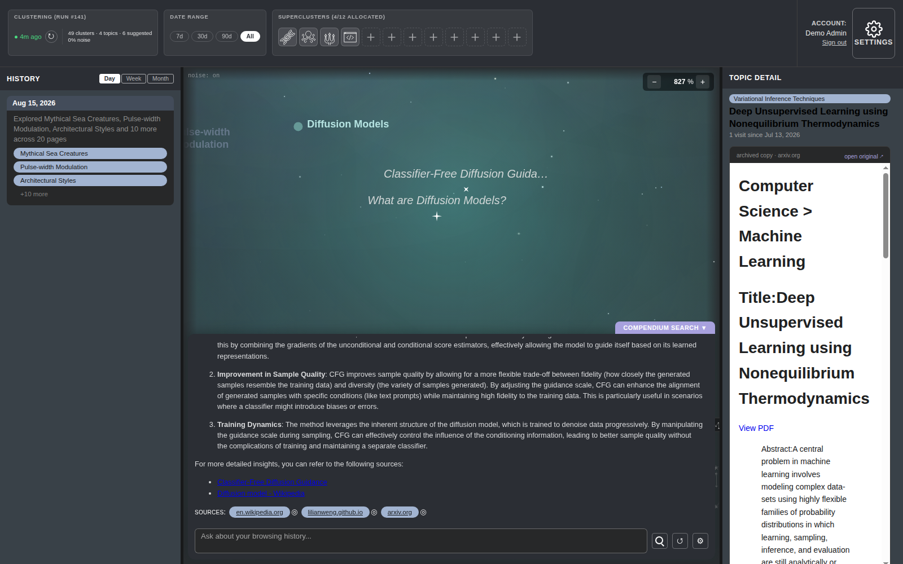

# Compendium


This project aims to turn curiosity-driven browsing into a topic-based knowledge compendium. Every page browsed gets filtered through a skip gate and then clustered into topics, laid out as an explorable constellation graph, and made queryable through a RAG chat agent that cites its sources back onto the graph. On top of the automatically-clustered layer, users can manually select "superclusters" (clusters of clusters) representing topics they are interested in to highlight in the graph.



## Quickstart

- [Hosted demo (read-only)](#hosted-demo-read-only)
- [Local demo (Node 22+)](#local-demo-node-22)
- [Full stack (Docker)](#full-stack-docker)

### Hosted demo (read-only)

Browse a read-only hosted demo instance at https://compendium.skaniti.dev. It contains a sample compendium curated from publicly licensed web pages (Wikipedia, arXiv, GitHub, Stack Exchange, and a few others) spanning four topics: diffusion models, Greek/Roman mythology, electronics/Arduino, and cephalopods. Chat on the hosted instance runs the live RAG agent. The local demo below replays recorded answers.

### Local demo (Node 22+)

Requires **Node 22+**.

```bash
git clone https://github.com/skaniti/compendium.git
cd compendium
npm ci
npm run demo
```

`npm run demo` boots a dependency-free stub backend (`apps/web/demo/server.mjs`) serving the same curated demo data as in the read-only demo, plus the Next.js dev server pointed at it. The demo drops the user straight into the populated app: graph, diary, topic detail, and chat interface are live, under a single local identity with full control over the synthetic data. Demo mode exists to explore the app before committing to personal use; building a compendium from real browsing requires the backend and collectors.

**Data:** The demo data is respread across a plausible browsing timeline that will appear "recent" no matter when the repo is cloned. Full source list and licensing notes: `apps/web/demo/fixtures/ATTRIBUTION.md`. The seed also carries a small synthetic archived/skipped population (temporary; see `apps/api/data/demo-seed/README.md`) so the Pipeline dev view has data, and `apps/web/demo/fixtures/pipeline/` is recorded from it.

**Chat:** 12 question/answer runs from the live agent are recorded in `apps/web/demo/fixtures/chat/index.json`. The search bar at the bottom of the graph replays them token-by-token over SSE, complete with source pills that frame the cited nodes back on the graph. Anything else typed in falls back to a response that explains demo mode and lists the 12 recorded questions.

**Mutations:** Topic edits, exclusions, and preference writes persist for the life of the stub process and reset on restart. Clicking `Recluster` waits a couple of seconds and bumps the run number but does not actually recluster the data in demo mode.





## Full-stack (Docker)

The local quickstart is frontend-only and already populated. Docker Compose runs the full stack: Postgres, the FastAPI backend (`apps/api`), and the frontend, with the compendium set up to populate with your own data. The two ways to populate your compendium currently are a browser extension for desktop/laptop (Firefox-only) and a browser app for Android (build from source). An option for uploading your own data, if you don't want to use the extra fixtures, is in progress.

You need Docker and an OpenAI API key. Ingesting pages and chatting both spend OpenAI credit.

**1. Fill in `.env`.**

```bash
git clone https://github.com/skaniti/compendium.git
cd compendium
cp -n .env.example .env
```

(`-n` keeps an existing `.env`.) Open `.env` and set the five required values: your login (`BOOTSTRAP_EMAIL`, and `BOOTSTRAP_PASSWORD` with at least 8 characters), `OPENAI_API_KEY`, and two random secrets, `JWT_SECRET_KEY` and `SESSION_INGRESS_TRUSTED_VALUE`. Generate each secret with:

```bash
openssl rand -hex 32
```

Single-quote any value that contains `$`, `#` or spaces. `docker compose` refuses to start until all five are set, and names the one that's missing.

Shortcut: `bash scripts/setup-env.sh` asks for your email, password and OpenAI key, generates the two secrets, and writes `.env` from `.env.example` in one step. It refuses to overwrite an existing `.env`, and never prints your password or keys. It needs bash (macOS, Linux or WSL); on Windows without WSL, use the steps above.

**2. Start it.**

```bash
docker compose up --build
```

Postgres starts, `apps/api` runs its migrations and creates your login from `.env`, then `apps/web` builds and starts. The first run builds the backend's Python dependencies and downloads its models (a few minutes); after that, `docker compose up` is fast. It runs in the foreground and shows the logs, so run step 4's command in a second terminal in the same folder.

**3. Sign in** at **http://localhost:3000** with the email and password from `.env`. The compendium stays empty until the collectors send pages. Over plain `http://` the web UI works from this machine only: its sign-in cookies are secure-only, and browsers drop them there. To use it from other devices, see **Reaching it from other devices (Tailscale)** below.

**4. Get the collectors' API key.**

```bash
docker compose exec api sh -c 'ROTATE_EMAIL="$BOOTSTRAP_EMAIL" python -m backend.scripts.rotate_api_key'
```

It prints a new key once. Running it again issues a new key, and the old one stops working.

**5. Connect the collectors.**

- **Firefox extension:** in its settings, the backend URL is already `http://localhost:8001`; paste the key.
- **Android app:** in its settings, set the backend URL to `http://<this computer's LAN address>:8001` and paste the key. The phone has to be on the same network, and the computer's firewall has to allow port 8001. Away from home, the app keeps captures and sends them once it can reach the API again.

The key and your pages cross your network as plain HTTP. To keep the API on this machine only, set `API_BIND_ADDRESS=127.0.0.1` in `.env` and run `docker compose up -d` (`docker compose restart` keeps the old binding); the Android app then can't reach it.

**Reaching it from other devices (Tailscale).** With [Tailscale](https://tailscale.com) on this computer and your other devices, the Android app and the web UI work from anywhere on your tailnet:

- **Android app:** set the backend URL to `http://<this computer's tailnet address>:8001` (`tailscale ip -4` prints it). This needs the default `API_BIND_ADDRESS`.
- **Web UI:** run the command below on this computer, then open `https://<this computer's name>.<your tailnet>.ts.net` on any device in your tailnet. Tailscale serves it over HTTPS with a real certificate, so sign-in works there too. No `.env` change is needed.

If something else on this computer already serves port 443 through Tailscale, use another port in the `serve` and `off` commands below and add it to the address.

```bash
tailscale serve --bg --https=443 http://127.0.0.1:3000
```

If your tailnet doesn't have HTTPS certificates turned on yet, `tailscale serve` prints a link to enable them. The route stays across reboots until `tailscale serve --https=443 off` removes it.

Ports: web on `127.0.0.1:3000`, API on `:8001` (`:8001/health` for a liveness check). Postgres is not published to the host; only `api` can reach it. Stop with `docker compose down`. **`docker compose down -v` deletes your compendium**: the Postgres and preview-asset volumes, along with the model cache.

Your login is re-applied from `.env` on every boot. To change your password, edit `BOOTSTRAP_PASSWORD` in `.env` and run `docker compose up -d`; `docker compose restart` keeps the old value. Changing `BOOTSTRAP_EMAIL` instead creates a new, empty account. If you ran an earlier version of this stack, its logins used published default passwords, and the first boot of this version disables them. To keep the data that version collected, set `BOOTSTRAP_EMAIL` to its account's email (`you@example.com` by default) and run `docker compose up -d`; the account then takes your `.env` password. Otherwise, start fresh with `docker compose down -v`.

## Tests

```bash
npm test
npm run test:extension
```

`npm test` runs the Vitest suite (component tests + the stub server's own smoke tests) headlessly via jsdom. `npm run test:extension` runs the browser extension's tests with Node's built-in test runner. CI runs both.

## Architecture

- **Frontend:** Next.js (App Router) at `apps/web`: graph canvas, diary/history panel, topic detail, header widgets, and the chat search bar. The repo is an npm-workspaces monorepo; root `npm` commands (`dev`, `build`, `test`, `lint`, `demo`) delegate to this workspace.
- **Typeface:** Almagest, at `apps/web/fonts/almagest`: an original caps-only constellation typeface in which every glyph is an asterism, in three optical sizes (Display, Mid, Text). It sets the supercluster names on the graph. `npm run fonts:build` compiles it into `apps/web/public/fonts/almagest/`.
- **API proxy:** `apps/web/app/api/[...path]/route.ts` forwards every `/api/*` call to whatever `BACKEND_URL` points at (passing the session cookie's token as a Bearer header and streaming SSE through unbuffered), so the frontend never talks to a backend host directly. `apps/web/app/captured-assets/[...path]/route.ts` is the same proxy for `/captured-assets/*` (page preview images/stylesheets), which the backend serves outside the `/api` prefix.
- **Demo backend:** `apps/web/demo/server.mjs`, a dependency-free Node HTTP server that answers the same endpoint contract from static fixtures under `apps/web/demo/fixtures/`. `npm run demo` (`apps/web/demo/launcher.mjs`) boots it and points `BACKEND_URL` at it automatically.
- **Real backend:** `apps/api`, a FastAPI service extracted from the predecessor project (see "Full-stack (Docker)" above). `BACKEND_URL` is the entire contract between this frontend and whatever serves it: `npm run demo`'s stub and `apps/api` both satisfy it.
- **Browser extension:** `apps/extension`, a Manifest V3 collector that passively tracks browsing and POSTs captures to `apps/api`. In Firefox 140+, open `about:debugging` → This Firefox → "Load Temporary Add-on…" and pick `apps/extension/manifest.json`. Temporary add-ons unload when Firefox restarts; a permanent install needs the extension signed through addons.mozilla.org.
- **Android collector:** `apps/android`, a GeckoView-based browser that captures sessions and POSTs them to `apps/api`, same as the extension. Builds via the Gradle wrapper (`./gradlew assembleRelease`, producing unsigned per-ABI APKs for arm64-v8a and x86_64); release signing is done separately.
- **Dev views:** at `/dev/<view>`, opened from the header's Dev button. Ported so far:
  - Overview: `/api/overview/summary`, `/api/overview/timeline`
  - Pipeline: `/api/pipeline/summary`, `/api/pipeline/timeline`, `/api/pipeline/pages`
  - Clusters: `/api/clusters/summary`, `/api/clusters/{id}/pages`, `/api/clusters/unclustered`
  - Prompts: `/api/prompts/summary`, `/api/prompts/templates/{name}`, plus admin-only override and evaluation-history routes
- **Roles:** the graph's debug overlay (the noise toggle and the view-demo/return-to-admin controls) appears only for an admin or an admin viewing as demo. The demo-account and view-as tooling exists for the hosted deployment and is off by default, behind `DEMO_ROLE_TOOLING` (stub) and `NEXT_PUBLIC_DEMO_ROLE_TOOLING` (frontend); `scripts/dev.sh` turns both on. `npm run demo` signs in automatically and never shows `/login`. On the hosted demo, `/login` shows only the Enter demo button; the Docker stack uses its password form.

## Status

This repo succeeds an earlier Dash + FastAPI prototype and was ported from it one surface at a time. Ported: the app shell, the diary/history and topic-detail panels, the header widgets, the constellation graph (a vendored D3 port with supercluster nameplates and a tunable layout), the streaming chat with source pills, the auth/session/role mechanics, and four dev views (Overview, Pipeline, Clusters, Prompts). The hosted instance runs this frontend on Vercel with `apps/api` behind it.

Still to port: the remaining dev views (data browser, logs, traces, dqBot). After that, the prototype's Dash app retires.

## Known limitations

The settled graph layout depends on how much noise is shown: toggling noise re-runs the full force simulation, and different node counts can settle into visibly different arrangements. A fix is tracked as follow-up work.

In the Docker stack, a signed-in session lapses after 60 idle minutes. The longer "remembered" session needs a trusted ingress in front of the app, which this stack doesn't have.

## Conventions

- **Commit format:** `type: subject`, lowercase, no scope parentheses, no AI attribution (`docs/references/COMMIT-FORMAT.md`), enforced by a husky `commit-msg` hook.
- **Pushes are gated:** the `pre-push` hook refuses to push unless `ALLOW_PUSH=1` is set.
- **Line endings:** LF repo-wide, enforced via `.gitattributes`.
- **Contributing:** `CONTRIBUTING.md`; conduct in `CODE_OF_CONDUCT.md`; vulnerability reports per `SECURITY.md`.

## License

MIT. See `LICENSE`.
